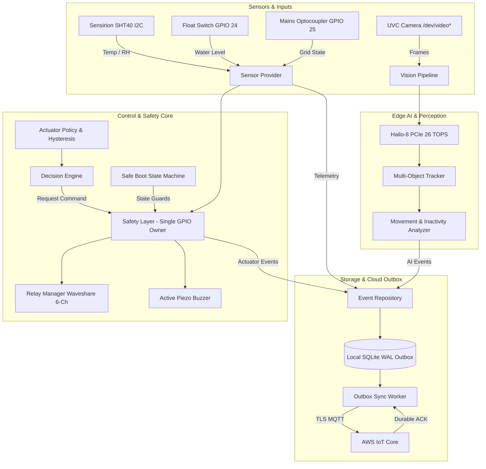
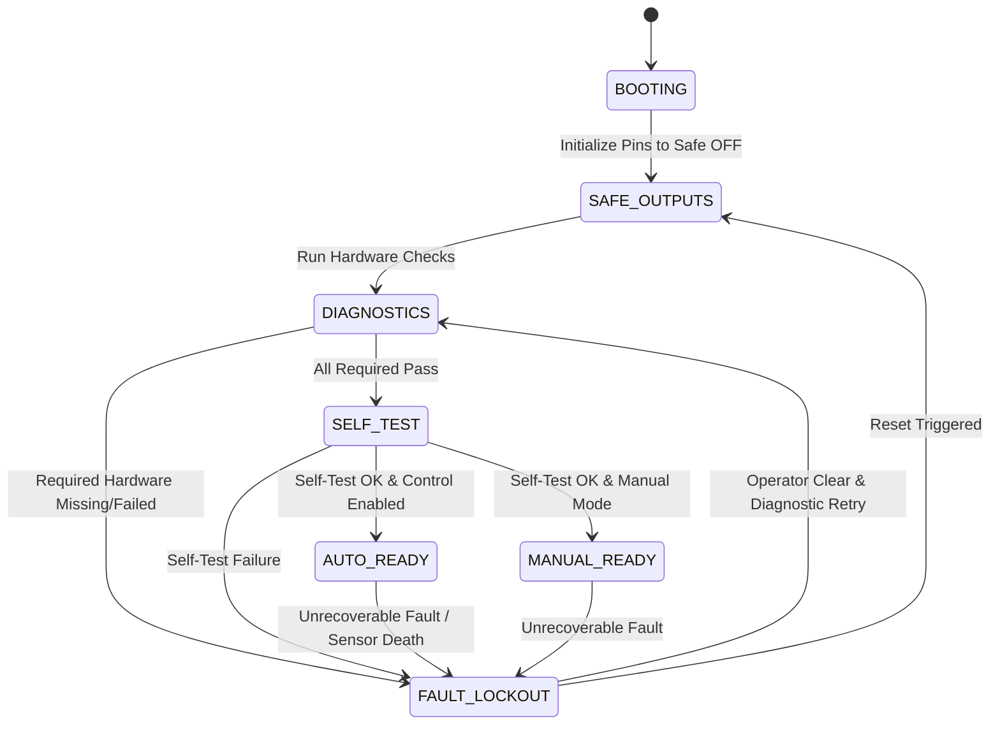

# Sericulture Edge-AI Software (Raspberry Pi 5)

Production-grade, functional-safety-minded embedded software for the **Sericulture Edge-AI Controller** running on a **Raspberry Pi 5 (64-bit Raspberry Pi OS Lite)** with a **Hailo-8 AI HAT+ (26 TOPS)**, **Sensirion SHT40**, **Waveshare 6-Channel Relay Module**, **UVC Camera**, **Magnetic Float Switch**, **Isolated AC Mains Detector**, and **Active Piezo Buzzer**.

---

## 1. System Overview & Safety Philosophy

Sericulture (silkworm rearing) requires strict environmental stability (temperature, humidity, ventilation, and photoperiod) and continuous silkworm activity monitoring. Actuator failure, software crashes, or electrical chatter can cause total crop loss or equipment fire.

### Functional Safety Guarantees
1. **Zero-Power Safe OFF Default:** All relay channels initialize to a verified safe OFF state on power application, process launch, reboot, uncaught exceptions, or watchdog timeouts. Relays will never chatter or briefly pulse during boot.
2. **Single GPIO Ownership:** Only the `SafetyLayer` may command the `RelayManager`. No other module possesses direct GPIO write access.
3. **Mains Power Loss Interlock:** Optocoupled mains monitor immediately drives all load control outputs OFF upon power interruption. Stabilization timer prevents rapid cycling upon generator or grid bounce.
4. **Water Tank Protection:** Magnetic float switch interlock prevents the mist sprayer pump from ever running dry, preventing pump motor burnout.
5. **Honest Observability:** Software distinguishes strictly between verified states (e.g. I²C ACK, PCIe probe) and unverifiable states (e.g. relay physical contact closure, buzzer sound pressure).
6. **Durable Cloud ACK Contract:** Local SQLite WAL outbox stores all events first. Records are never deleted upon mere MQTT `PUBACK` (`qos=1`); they require an explicit application-level ACK from AWS IoT Core.

---

## 2. System Architecture



---

## 3. Authoritative Pinout & Hardware Configuration

| Component | Function / Load | Physical Pin | BCM GPIO | Electrical Direction | Logic Mode / Polarity | Default Boot State |
| :--- | :--- | :--- | :--- | :--- | :--- | :--- |
| **Relay Ch 1** | Exhaust / Circulation Fan | Pin 29 | **BCM 5** | Output | Active-Low (`0` = ON, `1` = OFF) | Safe OFF (`1`) |
| **Relay Ch 2** | Mist Sprayer / Humidifier | Pin 31 | **BCM 6** | Output | Active-Low (`0` = ON, `1` = OFF) | Safe OFF (`1`) |
| **Relay Ch 3** | Day / Night Photoperiod Light | Pin 33 | **BCM 13** | Output | Active-Low (`0` = ON, `1` = OFF) | Safe OFF (`1`) |
| **Relay Ch 4** | Auxiliary / Heater Spare | Pin 36 | **BCM 16** | Output | Active-Low (`0` = ON, `1` = OFF) | Safe OFF (`1`) |
| **Relay Ch 5** | Expansion Channel | Pin 35 | **BCM 19** | Output | Active-Low (`0` = ON, `1` = OFF) | Safe OFF (`1`) |
| **Relay Ch 6** | Expansion Channel | Pin 37 | **BCM 26** | Output | Active-Low (`0` = ON, `1` = OFF) | Safe OFF (`1`) |
| **Piezo Buzzer** | Acoustic Fault Alarm | Pin 32 | **BCM 12** | Output | Active-High (`1` = BEEP, `0` = SILENT) | Silent (`0`) |
| **Float Switch** | Water Tank Level Switch | Pin 18 | **BCM 24** | Input | Internal Pull-Up (`0` = OK, `1` = LOW) | Monitored |
| **Mains Detector** | AC Mains Optocoupler | Pin 22 | **BCM 25** | Input | Pulled High (`1` = PRESENT, `0` = LOST) | Monitored |
| **SHT40 (SDA)** | Environmental Sensor SDA | Pin 3 | **BCM 2** | I²C Bus 1 | Standard I²C 3.3V | I²C Addr `0x44` |
| **SHT40 (SCL)** | Environmental Sensor SCL | Pin 5 | **BCM 3** | I²C Bus 1 | Standard I²C 3.3V | I²C Addr `0x44` |
| **Hailo-8 HAT+** | Vision AI Accelerator | PCIe Gen 2/3 | PCIe / M.2 | PCIe x1 | High-speed NPU 26 TOPS | `/dev/hailo0` |
| **UVC Camera** | Silkworm Tray Camera | USB 3.0 / 2.0 | USB Host | V4L2 | 1080p @ 15-30 FPS | `/dev/video*` |

*Note: Relay channels on the Waveshare 6-Channel module are configured as active-low by default (`active_low: true`), meaning pulling the GPIO LOW energizes the relay coil. During boot and safe shutdown, pins are held HIGH to ensure coils remain completely de-energized.*

---

## 4. Hardware Verification & Honest Observability Matrix

The system rejects superficial "everything is OK" reporting. Diagnostics distinguish between what the software can legitimately verify versus what is physically unverifiable without auxiliary feedback loops:

| Component | Diagnostic Check | Status Reported | Justification & Physical Truth |
| :--- | :--- | :--- | :--- |
| **SHT40 Sensor** | I²C read + CRC validation + range bounds | `PASS` / `FAIL` | Directly verified via bidirectional I²C protocol and checksums. |
| **Float Switch** | Digital GPIO read + Debounce | `PASS` / `FAIL` | Verified electrical contact state; physical float position inferred. |
| **Mains Monitor** | Optocoupler pulse read + Debounce | `PASS` / `FAIL` | Verified presence of optocoupler output. |
| **UVC Camera** | V4L2 device open + test frame capture | `PASS` / `FAIL` | Verified frame buffer generation, shape, and freshness. |
| **Hailo-8 NPU** | PCIe device probe + HEF model compile | `PASS` / `FAIL` | Verified PCIe bus recognition and HEF network configuration. |
| **Relay Outputs** | GPIO line allocation & level assertion | `UNVERIFIABLE` | **GPIO high/low is verified, but physical relay contact closure and load power are UNVERIFIABLE without current/voltage feedback sensors.** |
| **Piezo Buzzer** | GPIO level assertion | `UNVERIFIABLE` | **GPIO output verified, but acoustic sound emission is UNVERIFIABLE without a microphone sensor.** |
| **SQLite WAL** | Write canary + WAL journal check | `PASS` / `FAIL` | Verified local filesystem read/write and disk space availability. |
| **AWS IoT Core** | TLS handshake + MQTT connect | `PASS` / `OPTIONAL_MISSING` | Verified network path to cloud broker (optional for offline boot). |

---

## 5. Safe Boot State Machine



### Acoustic Buzzer Alert Patterns (Non-Blocking Engine)
When a fault triggers `FAULT_LOCKOUT`, the background buzzer driver sounds a distinct acoustic signature without blocking execution:

- **SHT40 Fault:** 1 short beep, 2 long beeps (repeat every 5s)
- **Camera Fault:** 2 short beeps, 1 long beep (repeat every 5s)
- **Hailo-8 Fault:** 2 short beeps, 2 long beeps (repeat every 5s)
- **Safety Input Fault (Mains / Float):** 3 short beeps, 1 long beep (repeat every 5s)
- **Storage / Database Fault:** 4 short beeps, 1 long beep (repeat every 5s)
- **GPIO / Config Fault:** Rapid continuous beeps (50ms on / 50ms off)

---

## 6. Durable Cloud Synchronization Contract

Unlike typical naive IoT clients that treat MQTT broker acknowledgment (`PUBACK`, `qos=1`) as permission to discard data, this system follows an **offline-first local database outbox contract**:

1. **Transactional Local Commit:** All telemetry, vision events, and actuator state changes are committed to local SQLite WAL tables inside a single ACID transaction alongside an outbox queue entry (`status='PENDING'`).
2. **Batched Drainer:** The `OutboxSyncWorker` reads pending batches (e.g. 50 events) and publishes them to AWS IoT Core under topic `sericulture/{farm_id}/{device_id}/outbox`.
3. **Application ACK Subscription:** The client subscribes to `sericulture/{farm_id}/{device_id}/ack`.
4. **Permanent Purge Condition:** Outbox entries are marked `SYNCED` **only** when a valid payload matching the event ID and timestamp is received on the ACK topic:
   ```json
   {
     "device_id": "pi5-sericulture-01",
     "acknowledged_ids": ["c1a8...", "f4b2..."],
     "server_timestamp_utc": "2026-10-10T04:22:00Z"
   }
   ```
5. **No Loss During Network Outages:** If the Pi loses internet connectivity for hours or days, records accumulate safely in local SQLite. The retention pruner **never deletes unsynced records**, regardless of age.

---

## 7. Installation & Deployment

### Quick Install (Automated Script)
```bash
# Clone the repository
git clone https://github.com/novabion/sericulture_pi_software.git
cd sericulture_pi_software

# Run installation script as root
sudo ./scripts/install.sh
```

The script automatically:
1. Creates the isolated system user `sericulture` and assigns hardware groups (`gpio`, `i2c`, `video`, `dialout`).
2. Provisions restrictive directories:
   - Application: `/opt/sericulture` (mode 750)
   - Database / Data: `/var/lib/sericulture` (mode 750)
   - Configuration / TLS: `/etc/sericulture` (mode 700)
3. Configures a Python 3.12 virtual environment and installs all dependencies.
4. Deploys the sandboxed systemd service `/etc/systemd/system/sericulture.service`.

### Configuration
Edit the configuration file with your specific device, farm, and AWS endpoint details:
```bash
sudo nano /etc/sericulture/device.yaml
```

Place your AWS IoT Core X.509 device certificates in:
```bash
/etc/sericulture/certs/
├── ca.pem
├── cert.pem
└── key.pem
```

---

## 8. Service Management & CLI

```bash
# Start the background service
sudo systemctl start sericulture.service

# View real-time structured logs
sudo journalctl -u sericulture.service -f

# Check service status
sudo systemctl status sericulture.service

# Stop the service safely (forces all relays OFF before exit)
sudo systemctl stop sericulture.service

# Run manual diagnostics CLI check without starting full controller
sericulture --config /etc/sericulture/device.yaml --diagnostics-only
```

---

## 9. Hardware Commissioning Checklist

Before enabling automatic load control in a live rearing environment, execute this step-by-step physical commissioning procedure:

- [ ] **1. Power Off Check:** Measure continuity between relay common (COM) and normally open (NO) terminals. All loads must be open-circuit.
- [ ] **2. Single-Wire Test:** Disconnect relay input cable. Relays must remain completely de-energized.
- [ ] **3. Boot Verification:** Power on the Pi 5. Verify visually that no relay clicks or indicators flicker during Linux kernel boot.
- [ ] **4. Float Switch Validation:** With mist reservoir empty, verify float switch diagnostic reports `WATER_LOW`. Attempting manual mist spray must be blocked by the `SafetyLayer`. Fill reservoir with water and confirm state transitions to `WATER_OK`.
- [ ] **5. Mains Power Loss Validation:** Connect a 12V test light to Relay Ch 1 (Fan). Energize fan via manual command. Disconnect AC mains input to optocoupler. Verify relay turns OFF in `< 50ms`. Reconnect mains and confirm relay does NOT turn back on until the configured stabilization delay elapses.
- [ ] **6. Camera & Hailo-8 Validation:** Verify UVC camera appears at `/dev/video0` and Hailo-8 NPU appears at `/dev/hailo0`. Confirm inference pipeline generates silkworm count and activity metrics without frames dropping below 10 FPS.
- [ ] **7. Domain Threshold Approval:** Set `control.provisional: false` in `device.yaml` only after sericulture agronomists review temperature, humidity, and lighting thresholds.

---

## 10. Running Automated Tests

The codebase includes comprehensive unit, integration, and fault injection tests:

```bash
# Run the complete test suite (38 tests)
python3 -m pytest

# Run fault injection recovery tests
python3 -m pytest tests/fault_injection/

# Run safe boot integration tests
python3 -m pytest tests/integration/
```

---

## License & Ownership

Proprietary and Confidential. Copyright © 2026 Novabion Engineering. All rights reserved.
